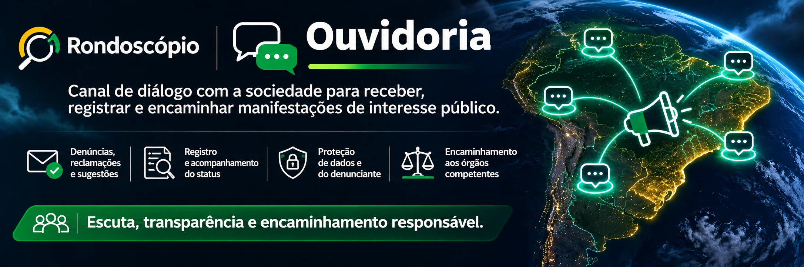

# Ouvidoria

Projeto do **Rondoscópio** no repositório **Rondoscopio/ouvidoria**.

A Ouvidoria pretende ser o canal de diálogo entre a sociedade e o Rondoscópio para receber, registrar, organizar e encaminhar manifestações de interesse público. Seu escopo inclui denúncias, reclamações, sugestões, solicitações, elogios, pedidos de correção e demandas relacionadas à atuação da própria iniciativa.

## Recebimento e acompanhamento

O sistema deverá permitir registrar manifestações e acompanhar seu tratamento, com histórico das providências, responsáveis autorizados, alterações de estado e encaminhamentos cabíveis. Os relatos serão avaliados conforme sua natureza, relevância e documentação disponível, sem transformar alegações em fatos comprovados.

Quando uma manifestação indicar possível irregularidade, ela poderá subsidiar o trabalho do [Observador](https://github.com/Rondoscopio/observador) e do [Auditor](https://github.com/Rondoscopio/auditor), respeitados os critérios de acesso e as verificações necessárias. O encaminhamento a instituições competentes dependerá da análise do caso, das obrigações legais e dos riscos envolvidos.

## Proteção do manifestante

A Ouvidoria deverá adotar minimização de dados, controle de acesso, rastreabilidade de consultas, proteção de informações sensíveis e procedimentos específicos para manifestações confidenciais. A identificação de denunciantes e fontes protegidas não deverá ser divulgada sem fundamento jurídico e autorização apropriados.

A possibilidade de manifestação anônima, os mecanismos de comunicação segura e os procedimentos de resposta serão definidos antes da abertura do serviço. Nenhum canal deve prometer anonimato ou confidencialidade que ainda não consiga garantir tecnicamente.

O Rondoscópio não é órgão policial, Ministério Público, tribunal ou ouvidoria governamental. O recebimento de um relato não significa instauração de investigação oficial nem substitui os canais legalmente competentes.

**Projeto em planejamento.** Ainda não há canal de denúncias operacional. Não envie relatos sensíveis, documentos sigilosos, credenciais ou dados pessoais por issues, pull requests ou discussões públicas do GitHub.

Os princípios de atuação e proteção de pessoas são tratados na [Constituição do Rondoscópio](https://github.com/Rondoscopio/constituicao).

## License

**SPDX-License-Identifier:** `AGPL-3.0-or-later`

This project is Free Software: You can use, study, share and improve it at your
will. Specifically, you can redistribute and/or modify it under the terms of the
[GNU Affero General Public License](https://www.gnu.org/licenses/agpl-3.0.html) as
published by the Free Software Foundation, either version 3 of the License, or
(at your option) any later version.

---
